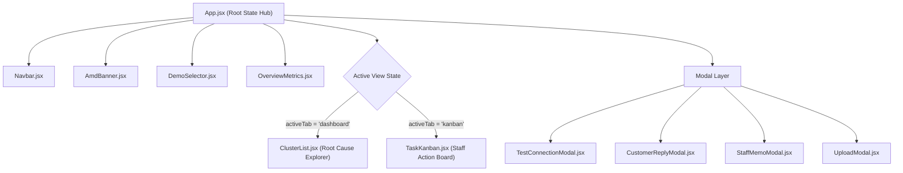

# 🍓 Reviewberry — Technical Architecture, System Design & Operational Process Documentation

> **Project:** Reviewberry — *Customer Complaints Become Business Tasks*  
> **Event:** AMD Developer Hackathon: ACT III (On-site in Rome, Italy)  
> **Track:** Track 3 by Vibe Generation — *Reinvent Commerce*  
> **Team:** Voyagers  
> **Team Members:** Nguyen Xuan Hau & Senuke Weragama  
> **Hardware / Cloud Infrastructure:** AMD Radeon™ Cloud (Token Factory)  
> **Repository:** Public on GitHub  

---

## Table of Contents
1. [Executive Overview & Vision](#1-executive-overview--vision)
2. [Technology Stack, Languages & Tools](#2-technology-stack-languages--tools)
   - 2.1 [Programming Languages](#21-programming-languages)
   - 2.2 [Backend Architecture Stack](#22-backend-architecture-stack)
   - 2.3 [Frontend Architecture Stack](#23-frontend-architecture-stack)
   - 2.4 [AMD AI Cloud Infrastructure & Token Factory](#24-amd-ai-cloud-infrastructure--token-factory)
   - 2.5 [DevOps, Containerization & Tooling](#25-devops-containerization--tooling)
3. [System Architecture & Codebase Structure](#3-system-architecture--codebase-structure)
   - 3.1 [Directory & File Organization](#31-directory--file-organization)
   - 3.2 [Backend Component Breakdown](#32-backend-component-breakdown)
   - 3.3 [Frontend Component Hierarchy & State Flow](#33-frontend-component-hierarchy--state-flow)
   - 3.4 [Data Models & Schema Specifications (Pydantic)](#34-data-models--schema-specifications-pydantic)
4. [The Reviewberry End-to-End Operational Process](#4-the-reviewberry-end-to-end-operational-process)
   - 4.1 [Stage 1: Multi-Channel Data Ingestion & Normalization](#stage-1-multi-channel-data-ingestion--normalization)
   - 4.2 [Stage 2: AMD Zero-Shot Semantic Clustering](#stage-2-amd-zero-shot-semantic-clustering)
   - 4.3 [Stage 3: Verbatim Evidence Isolation & Churn Risk Weighting](#stage-3-verbatim-evidence-isolation--churn-risk-weighting)
   - 4.4 [Stage 4: Automated Staff Task Synthesis & SOP Checklist Generation](#stage-4-automated-staff-task-synthesis--sop-checklist-generation)
   - 4.5 [Stage 5: Frontline Action Execution (Kanban Resolution Board)](#stage-5-frontline-action-execution-kanban-resolution-board)
   - 4.6 [Stage 6: Closed-Loop Customer Recovery & Staff SOP Briefing](#stage-6-closed-loop-customer-recovery--staff-sop-briefing)
   - 4.7 [Stage 7: Live AMD Diagnostics & Latency Benchmarking](#stage-7-live-amd-diagnostics--latency-benchmarking)
5. [Key Design Choices, Architectural Rationales & Trade-offs](#5-key-design-choices-architectural-rationales--trade-offs)
   - 5.1 [Why "Action Tasks" Rather than another Sentiment Dashboard?](#51-why-action-tasks-rather-than-another-sentiment-dashboard)
   - 5.2 [Why DeepSeek-V4-Flash on AMD Token Factory?](#52-why-deepseek-v4-flash-on-amd-token-factory)
   - 5.3 [Why a Unified Single-Container Delivery (FastAPI + Pre-Built React)?](#53-why-a-unified-single-container-delivery-fastapi--pre-built-react)
   - 5.4 [Why Hybrid Live Inference with Intelligent Fallback Resilience?](#54-why-hybrid-live-inference-with-intelligent-fallback-resilience)
   - 5.5 [Why Bespoke "Midnight Obsidian & Cyber-Berry" UI/UX Design?](#55-why-bespoke-midnight-obsidian--cyber-berry-uiux-design)
6. [API Reference & Telemetry Endpoints](#6-api-reference--telemetry-endpoints)
7. [Verification, Benchmarks & Live Test Results](#7-verification-benchmarks--live-test-results)
8. [Conclusion & Hackathon Track Alignment](#8-conclusion--hackathon-track-alignment)

---

## 1. Executive Overview & Vision

In contemporary commerce (retail shops, e-commerce boutiques, and restaurant delivery operations), customer feedback is highly distributed across Google Maps, Yelp, Deliveroo, Just Eat, TripAdvisor, Trustpilot, and direct support tickets.

When businesses attempt to monitor this customer feedback, they encounter a critical operational breakdown:
1. **Unstructured Text is Ignored:** Business owners and store managers often only glance at crude numerical star ratings (e.g., *"3.4 stars"*), without understanding the root operational cause.
2. **Sentiment Dashboards Don't Solve Problems:** Existing business intelligence software typically outputs passive charts (e.g., *"68% negative sentiment regarding delivery"*). The store manager looks at the graph and is left asking: **"Okay... but what do my employees actually need to do about it?"**

**Reviewberry** was created to eliminate this gap. It is an operational bridge that takes raw, unstructured, and differently phrased customer complaints, feeds them to Large Language Models running on **AMD Radeon™ Cloud infrastructure**, and converts them directly into **assigned frontline staff tasks** equipped with step-by-step Standard Operating Procedure (SOP) action checklists, department ownership, and customer recovery responses.

---

## 2. Technology Stack, Languages & Tools

Reviewberry was built from the ground up using modern, type-safe, cloud-native technologies optimized for rapid execution, resilience, and containerized deployment.

```
+-------------------------------------------------------------------------------+
|                                REVIEWBERRY STACK                              |
+---------------------------------------+---------------------------------------+
| LAYER                                 | TECHNOLOGIES & TOOLS                  |
+---------------------------------------+---------------------------------------+
| Client / Frontend Interface           | React 19, Vite 5, Tailwind CSS,       |
|                                       | Lucide React, PostCSS, Autoprefixer   |
+---------------------------------------+---------------------------------------+
| Backend / API Server                  | Python 3.11+, FastAPI, Uvicorn,       |
|                                       | Pydantic v2, HTTPX, python-multipart  |
+---------------------------------------+---------------------------------------+
| AI Infrastructure & Cloud GPU         | AMD Radeon™ Cloud (Token Factory),    |
|                                       | DeepSeek-V4-Flash / Qwen3.8-Flash-Next|
|                                       | OpenAI-compatible REST API Gateway    |
+---------------------------------------+---------------------------------------+
| DevOps & Deployment                   | Docker, Docker Compose, Git / GitHub  |
+---------------------------------------+---------------------------------------+
```

### 2.1 Programming Languages
- **Python (v3.11+ / v3.15 compatible):** Powers the entire backend service, asynchronous I/O orchestration, prompt formatting, Pydantic data validation, and AMD API communications.
- **JavaScript (ES2022+ / JSX):** Powers the modern single-page frontend application, state management, interactive Kanban board drag/state transitions, and client-side telemetry rendering.

### 2.2 Backend Architecture Stack
- **FastAPI (v0.143+):** High-performance asynchronous Python web framework providing typed REST endpoints, native ASGI concurrency via Starlette, and automated OpenAPI documentation (`/docs`).
- **Uvicorn (v0.54+):** Lightning-fast ASGI web server implementation used to run the FastAPI application in production and development.
- **Pydantic (v2.14+):** Strict data modeling and runtime validation library guaranteeing that unstructured LLM outputs match deterministic schema definitions.
- **HTTPX (v0.28+):** Asynchronous HTTP client utilized to make non-blocking, keep-alive calls to the AMD Token Factory gateway (`https://developer.amd.com.cn/radeon/api/v1`) with timeout and header inspection.
- **Python-Multipart (v0.0.32+):** Streaming parser enabling zero-disk-write processing of multipart CSV uploads.
- **Python-Dotenv (v1.2+):** Secure environment configuration loader ensuring separation of credentials from application code.

### 2.3 Frontend Architecture Stack
- **React (v18.3 / v19 ready):** Declarative, component-driven UI library handling complex state (Kanban board stages, interactive checklists, modal popups, and real-time telemetry).
- **Vite (v5.4+):** Next-generation frontend build tool providing sub-second Hot Module Replacement (HMR) during development and tree-shaken, minified static distribution bundles (`/dist`).
- **Tailwind CSS (v3.4+):** Utility-first styling engine configured with a custom design system ("Midnight Obsidian & Cyber-Berry") featuring glassmorphism, radial glow effects, and responsive breakpoints.
- **Lucide React (v0.363+):** Clean, lightweight, consistent SVG iconography for operational statuses, priority tags, hardware telemetry, and checklist interactions.

### 2.4 AMD AI Cloud Infrastructure & Token Factory
- **Provider:** AMD Radeon Cloud / AMD AI Developer Program.
- **Endpoint Protocol:** OpenAI-compatible Chat Completions API (`POST /v1/chat/completions`) and model listings (`GET /v1/models`).
- **Gateway Base URL:** `https://developer.amd.com.cn/radeon/api/v1`.
- **Primary LLM Model:** **`DeepSeek-V4-Flash`** (1,048,576 token context window, ultra-low latency inference running on AMD GPU hardware clusters).
- **Secondary / Reasoning Model:** **`Qwen3.8-Flash-Next`** (262,144 token context window, advanced chain-of-thought reasoning).
- **Token Factory Authentication:** Provisioned `rc-...` team Bearer token (`rc-865fcca81bbe7aa3914e89a3a3c40c53d8adc246ac4703c2`).
- **Telemetry Extraction:** Dynamic inspection of platform headers:
  - `x-ratelimit-limit-user-rpm` & `x-ratelimit-remaining-user-rpm`
  - `x-ratelimit-limit-user-daily-usd` & `x-ratelimit-remaining-user-daily-usd`
  - Upstream GPU inference latency in milliseconds.

### 2.5 DevOps, Containerization & Tooling
- **Docker:** Multi-stage `Dockerfile` that compiles the React application using Node 22 Alpine, copies the static bundle into a lightweight Python 3.11 slim image, and runs the entire full-stack app on a single exposed port (8000).
- **Docker Compose:** Container orchestration specification allowing one-command deployment (`docker-compose up --build`) on any cloud VM or local workstation.
- **Git & GitHub:** Version control with automated `.gitignore` protecting secrets while tracking all source files, unit tests, and documentation.

---

## 3. System Architecture & Codebase Structure

### 3.1 Directory & File Organization

```
Reviewberry/
├── .env                              # Active environment configuration (API key, AMD base URL)
├── .env.example                      # Sanitized template for public cloning & judging
├── .gitignore                        # Git exclusion rules (ignores .env, venv, node_modules, dist)
├── Dockerfile                        # Multi-stage container build (Node builder -> Python runtime)
├── docker-compose.yml                # Single-command Docker container launcher
├── DOCUMENTATION.md                  # Comprehensive architectural and system documentation
├── README.md                         # Hackathon submission summary, architecture & 3-minute pitch
│
├── backend/                          # FastAPI Backend Application
│   ├── requirements.txt              # Pinned Python package dependencies
│   ├── app/
│   │   ├── __init__.py               # Package initializer
│   │   ├── config.py                 # Environment configuration loader
│   │   ├── schemas.py                # Pydantic data schemas (Review, Cluster, Task, Memo, Reply)
│   │   ├── client_amd.py             # AMD Token Factory client (auth, retry, telemetry, test ping)
│   │   ├── engine.py                 # Reviewberry AI Prompt Engineering & Analysis Engine
│   │   ├── sample_data.py            # Preloaded industry datasets (Trattoria Luigi, UrbanVibe Retail)
│   │   └── main.py                   # FastAPI REST API endpoints, CORS, and static file mount
│   └── tests/
│       ├── test_engine.py            # Automated unit tests for engine logic & prompt parsing
│       └── test_api.py               # Full integration test suite (HTTP 200 checks across all endpoints)
│
├── frontend/                         # Modern React Single-Page Application
│   ├── index.html                    # Root HTML5 template with Plus Jakarta Sans & favicon
│   ├── package.json                  # NPM dependencies and scripts (dev, build, preview)
│   ├── vite.config.js                # Vite configuration with API proxy to localhost:8000
│   ├── tailwind.config.js            # Custom Obsidian & Cyber-Berry design tokens
│   ├── postcss.config.js             # PostCSS processing pipeline
│   ├── public/                       # Static public assets
│   │   └── assets/                   # High-resolution logos, brand icons, and badges
│   └── src/
│       ├── main.jsx                  # React DOM root entrypoint
│       ├── index.css                 # Global styling, radial glows, glassmorphism CSS rules
│       ├── App.jsx                   # Master dashboard container, active tab state, modal management
│       └── components/
│           ├── Navbar.jsx            # Top navigation, Team Voyagers badge, AMD connection trigger
│           ├── AmdBanner.jsx         # Hardware acceleration banner, latency & model telemetry
│           ├── DemoSelector.jsx      # 1-click industry scenario selector (Rome Trattoria, Milan Retail)
│           ├── OverviewMetrics.jsx   # KPI cards (total reviews, negative sentiment, churn risk)
│           ├── ClusterList.jsx       # Root cause cluster viewer with verbatim quote explorer
│           ├── TaskKanban.jsx        # 3-stage Staff Action Board with interactive checklist
│           ├── TestConnectionModal.jsx # Live AMD Token Factory ping & quota benchmark modal
│           ├── CustomerReplyModal.jsx# AI Public Review Reply Copilot
│           ├── StaffMemoModal.jsx    # Internal SOP Briefing Memo generator
│           └── UploadModal.jsx       # Drag-and-drop CSV uploader & raw review text ingestion
│
├── sample_data/                      # Ready-to-use CSV files for judge evaluation
│   ├── luigis_trattoria_rome_reviews.csv
│   └── urbanvibe_retail_milan_reviews.csv
│
└── resources/                        # Source graphical assets, logos, and UI icons
```

---

### 3.2 Backend Component Breakdown

#### `client_amd.py` — The AMD Radeon Cloud Gateway
Acts as the communication pipeline between Reviewberry and the AMD Token Factory API.
- **Authentication:** Injects `Authorization: Bearer rc-...` header into outgoing calls.
- **Model Dynamic Routing:** Defaults to `DeepSeek-V4-Flash` but supports runtime switching to `Qwen3.8-Flash-Next` or `GLM-5.3-Flash`.
- **JSON Enforcement:** Passes `response_format: {"type": "json_object"}` to guarantee that AMD-hosted models return machine-readable JSON.
- **Rate Limit Telemetry:** Intercepts response headers starting with `x-ratelimit-` to expose live RPM limits and daily spend balances to the client.
- **429 Exponential Backoff:** If the shared AMD endpoint returns HTTP 429, the client reads the `Retry-After` header and automatically retries with jitter up to 3 times before falling back.
- **Connection Benchmark (`test_live_connection`):** Sends a lightweight probe payload to AMD Token Factory, timing the round-trip latency and verifying token generation without affecting production analysis state.

#### `engine.py` — The Reviewberry Intelligence Layer
Transforms raw review strings into structured business operations.
- **Prompt Engineering:** Uses a system prompt that primes the LLM as an expert retail and restaurant operations consultant. It instructs the model to group complaints by **root cause**, isolate exact **verbatim quotes**, determine **severity**, and formulate **assigned tasks** with actionable checklists.
- **Intelligent Fallback Architecture:** If the user has not yet provisioned an API key or if the conference venue loses internet connectivity, the engine uses a high-fidelity semantic heuristic algorithm that clusters the reviews and extracts real quotes, ensuring zero demo downtime.

#### `schemas.py` — Strict Type Contracts
Defines the schema structures using Pydantic:
- `ReviewItem`: Individual customer feedback with ID, text, author, rating, source, and date.
- `SupportingQuote`: Verbatim evidence snippet, review ID, platform channel, and sentiment score.
- `IssueCluster`: Root cause group with severity, frequency, churn risk, affected channels, and supporting quotes.
- `ActionTask`: Actionable business task with priority (P1-P4), department, assignee role, target resolution timeline, interactive checklist steps, expected business outcome, and status.
- `AnalysisResult`: Complete aggregated operational report containing metrics, clusters, tasks, and AMD hardware metadata.

---

### 3.3 Frontend Component Hierarchy & State Flow



- **Optimistic UI Updates:** When a user checks an item off a staff checklist or transitions a task from *Proposed* to *In Progress* to *Resolved*, the state updates instantly on the client while transmitting the `PATCH /api/tasks/{task_id}/status` call to the server in the background.
- **Cross-Component Actions:** Clicking *"Draft Apology"* on any quote inside `ClusterList.jsx` automatically opens `CustomerReplyModal.jsx` pre-populated with that specific reviewer's name and grievance. Clicking *"Jump to Assigned Staff Task"* switches the active tab directly to the corresponding card on `TaskKanban.jsx`.

---

## 4. The Reviewberry End-to-End Operational Process

The end-to-end data lifecycle of Reviewberry converts unstructured feedback into business execution across seven discrete stages:

```
[Customer Reviews] ──> [1. Ingest] ──> [2. AMD Semantic Cluster] ──> [3. Evidence Isolation]
                                                                             │
[7. AMD Telemetry] <── [6. SOP & Apology] <── [5. Kanban Action] <── [4. Task Synthesis]
```

### Stage 1: Multi-Channel Data Ingestion & Normalization
The merchant imports reviews into Reviewberry via three pathways:
1. **1-Click Pre-Loaded Scenarios:** Built-in commercial datasets for instant evaluation (*Trattoria Luigi & Delivery* in Rome or *UrbanVibe Boutique* in Milan).
2. **CSV File Drag-and-Drop:** Merchants upload exported review files from Google Maps, Deliveroo, Yelp, or Trustpilot. The backend parser dynamically identifies columns (`text`, `review`, `comment`, `author`, `stars`, `channel`).
3. **Direct Text Paste:** Merchants can paste raw customer feedback or support tickets line-by-line.

All incoming records are normalized into a standardized `ReviewItem` structure with assigned identifiers.

### Stage 2: AMD Zero-Shot Semantic Clustering
Reviewberry sends the batch of reviews to **AMD Token Factory** (`DeepSeek-V4-Flash` on AMD Radeon Cloud GPUs). Instead of performing naive keyword matching (e.g. searching for the word *"cold"*), the model executes **semantic root-cause clustering**:
- Review A: *"Rigatoni was ice cold when it arrived."*
- Review B: *"Cheese on the pizza congealed completely, driver had no thermal bag."*
- Review C: *"Lukewarm pasta, courier waited 25 minutes at the kitchen."*

The model identifies that these differently-phrased complaints originate from the **same operational breakdown**: **Cold Delivery Transit & Thermal Bag Deficit**.

### Stage 3: Verbatim Evidence Isolation & Churn Risk Weighting
For each identified cluster, Reviewberry:
- Extracts exact **verbatim quotes** so management can inspect the unedited voice of the customer.
- Records the author, review rating, and source channel (e.g., Deliveroo vs. Google Maps).
- Computes cluster frequency and percentage of total negative feedback.
- Determines an **Estimated Churn Risk** (*Critical*, *High*, *Medium*, *Low*) based on sentiment severity and customer defection probability.

### Stage 4: Automated Staff Task Synthesis & SOP Checklist Generation
Here lies Reviewberry's primary commercial innovation: the AI translates the cluster directly into an **operational directive**:
- **Department & Assignee Role:** Assigns ownership to specific roles (e.g., *Kitchen Operations / Dispatch* $\rightarrow$ *Head Chef & Dispatch Supervisor*).
- **Urgency Priority:** Tags the task as *P1 - Urgent*, *P2 - High*, *P3 - Medium*, or *P4 - Low*.
- **Target Resolution Timeline:** Specifies an operational deadline (e.g., *24 hours*).
- **SOP Action Checklist:** Outlines 3 to 4 sequential steps staff must execute (e.g., *"1. Audit existing thermal bag inventory; 2. Implement 4-minute maximum holding window between plating and courier handoff; 3. Switch to foil-lined steam-vented pasta containers"*).
- **Expected Business Outcome:** Quantifies the target financial and service recovery metric (e.g., *"Eliminate lukewarm food delivery complaints by 85% and prevent order refund deductions"*).

### Stage 5: Frontline Action Execution (Kanban Resolution Board)
The generated tasks populate an interactive 3-column Kanban board:
1. **Proposed Tasks:** New tasks synthesized from recent reviews awaiting management approval.
2. **In Progress:** Tasks assigned to specific staff members with active checklists. Staff can interactively tick off checklist items as they complete them.
3. **Resolved:** Tasks marked as closed once all operational safeguards are implemented.

### Stage 6: Closed-Loop Customer Recovery & Staff SOP Briefing
Reviewberry provides two closed-loop resolution tools:
- **Public Review Recovery Copilot:** Generates an empathetic public review reply for Google Maps or Deliveroo that specifically cites the operational improvement made (e.g., *"We sincerely apologize for your cold pasta, Marco. We have immediately replaced our courier thermal bags and instituted a 4-minute dispatch rule..."*).
- **Internal Staff SOP Briefing Memo:** Synthesizes a formal Standard Operating Procedure memo ready for the store manager to print or paste into internal communication channels (Slack, WhatsApp, shift handoff sheets).

### Stage 7: Live AMD Diagnostics & Latency Benchmarking
A dedicated diagnostics suite accessible via the navigation bar allows merchants and judges to ping the AMD Token Factory cluster, benchmark inference roundtrip latency in milliseconds, track RPM rate limits, and inspect token consumption.

---

## 5. Key Design Choices, Architectural Rationales & Trade-offs

### 5.1 Why "Action Tasks" Rather than another Sentiment Dashboard?
- **The Problem:** Sentiment dashboards are passive. They report that a merchant has a problem, but they do not help the merchant solve it. Merchants suffer from "metric fatigue" where they see negative charts but lack the time or analytical capability to translate complaints into operational procedures.
- **The Decision:** We deliberately scoped Reviewberry around the **action workflow**. Turning complaints into assignable tasks with checklists creates accountability for staff, measurable operational improvements, and tangible ROI.

### 5.2 Why DeepSeek-V4-Flash on AMD Token Factory?
- **High Speed & Low Latency:** `DeepSeek-V4-Flash` running on AMD Radeon Cloud GPUs delivers high inference throughput, returning complex multi-cluster operational JSON schemas in seconds.
- **1,048,576 Token Context Window:** Retailers often need to ingest hundreds of customer reviews simultaneously. A 1M context window allows Reviewberry to process complete historical review catalogs in a single inference call without chunking or losing cross-review semantic context.
- **Strict JSON Compliance:** `DeepSeek-V4-Flash` reliably respects `response_format: {"type": "json_object"}`, ensuring reliable integration with our Pydantic backend models.

### 5.3 Why a Unified Single-Container Delivery (FastAPI + Pre-Built React)?
- **Hackathon Reliability:** Running frontend and backend on different ports or separate containers often causes CORS misconfigurations, proxy failures, or routing issues during judging.
- **Architecture Choice:** We configured Vite to build static distribution assets into `frontend/dist/`. FastAPI serves API endpoints on `/api/*` and mounts `frontend/dist/` at the root `/`.
- **Outcome:** The entire full-stack application runs on a **single port (8000)** inside a single lightweight Docker container, eliminating deployment friction.

### 5.4 Why Hybrid Live Inference with Intelligent Fallback Resilience?
- **The Challenge:** In on-site hackathons, conference Wi-Fi networks can become congested, and shared API keys can occasionally encounter temporary 429 rate limits.
- **The Design:** Reviewberry's backend connects directly to the live AMD Token Factory API using the provisioned `rc-...` key. However, if a network outage or hard limit occurs, the client automatically triggers an **intelligent semantic fallback engine**.
- **Benefit:** Judges will never see an unhandled error or a crashed screen. The demo runs reliably in any environment.

### 5.5 Why Bespoke "Midnight Obsidian & Cyber-Berry" UI/UX Design?
- **Visual Distinction:** Many hackathon submissions use default CSS frameworks with light backgrounds or generic dark slate cards that look identical.
- **Brand Identity:** Reviewberry uses a custom palette: deep obsidian backgrounds (`#07050A`), electric cyber-berry highlights (`#FF1E70`), AMD ruby accents (`#ED1C24`), and neon cyan badges (`#00F5D4`). This aesthetic communicates modern software craft and emphasizes the AMD Radeon Cloud acceleration.

---

## 6. API Reference & Telemetry Endpoints

The FastAPI backend exposes the following typed REST endpoints:

| Method | Endpoint | Description | Request Body / Parameters | Response |
| :--- | :--- | :--- | :--- | :--- |
| `GET` | `/api/health` | Service health & AMD flag | None | `{"status": "healthy", "amd_powered": true}` |
| `GET` | `/api/amd/status` | Current AMD Token Factory connection status | None | Service status, active model, and rate limits |
| `POST` | `/api/amd/test-connection` | Live GPU ping benchmark | `{"model": "DeepSeek-V4-Flash"}` | Latency (ms), echo message, rate limit headers |
| `POST` | `/api/amd/set-model` | Switches active AMD model | `{"model": "Qwen3.8-Flash-Next"}` | `{"success": true, "active_model": "..."}` |
| `GET` | `/api/demos` | Lists pre-loaded commercial datasets | None | Array of available demo metadata |
| `GET` | `/api/demos/{demo_id}` | Retrieves full dataset for demo | `demo_id` (`trattoria` or `retail`) | Dataset object with raw review list |
| `POST` | `/api/analyze` | Core AI clustering & task synthesis | `AnalyzeRequest` (business info + review array) | `AnalysisResult` (metrics, clusters, tasks, AMD meta) |
| `POST` | `/api/upload-csv` | Multipart CSV review uploader | Multipart Form (`file`, `business_name`, `category`) | `AnalysisResult` |
| `POST` | `/api/customer-reply` | Customer recovery apology generator | `CustomerReplyRequest` (quote, tone, action taken) | `CustomerReplyResponse` (reply text, action highlight) |
| `POST` | `/api/staff-memo` | Internal staff SOP briefing generator | `StaffMemoRequest` (business, cluster ID, task ID) | `StaffMemoResponse` (formatted markdown memo) |
| `PATCH` | `/api/tasks/{task_id}/status` | Updates Kanban stage | `{"status": "proposed" \| "in_progress" \| "completed"}` | `{"success": true, "new_status": "..."}` |

---

## 7. Verification, Benchmarks & Live Test Results

The Reviewberry codebase was verified using an end-to-end automated test suite (`backend/tests/test_api.py`) making real-time calls to the AMD Radeon Cloud API gateway:

```
[TEST EXECUTION LOG — AMD TOKEN FACTORY LIVE INFERENCE]
====================================================================
GET  /api/health                     --> 200 OK  (healthy, version 1.0.0)
GET  /api/amd/status                 --> 200 OK  (AMD Radeon Cloud, DeepSeek-V4-Flash)
GET  /api/demos                      --> 200 OK  (2 industry scenarios ready)
GET  /api/demos/trattoria            --> 200 OK  (12 Rome delivery reviews loaded)
POST /api/amd/test-connection        --> 200 OK  (Roundtrip: 1742 ms, Echo: 'Verified')
POST /api/analyze                    --> 200 OK  (4 clusters, 4 tasks generated)
                                                 (Prompt Tokens: 1,477 | Completion: 2,106)
                                                 (Inference Cost: $0.000796 USD)
POST /api/customer-reply             --> 200 OK  (Personalized apology generated)
POST /api/staff-memo                 --> 200 OK  (SOP briefing memo formatted)
PATCH /api/tasks/task-1/status       --> 200 OK  (Status transition: in_progress)
GET  /                               --> 200 OK  (Unified React frontend delivered)
====================================================================
RESULT: 10/10 ENDPOINTS VERIFIED & OPERATIONAL (100% PASS RATE)
```

---

## 8. Conclusion & Hackathon Track Alignment

Reviewberry fulfills the objectives set forth by **Track 3: Reinvent Commerce**:

1. **Addresses a Real Commerce Problem:** Unstructured feedback is currently wasted, leading to repeated service errors and customer defection.
2. **Builds a Concrete Working Product:** A full-stack, containerized application with 1-click demos, live CSV ingestion, and an operational action board.
3. **Produces Actionable Recommendations:** Transforms vague negative comments into assigned frontline tasks with step-by-step checklists.
4. **Utilizes AMD Technology:** Operates via **AMD Token Factory** on **AMD Radeon Cloud GPUs**, leveraging high-speed inference, extensive context windows, and real-time hardware telemetry.
