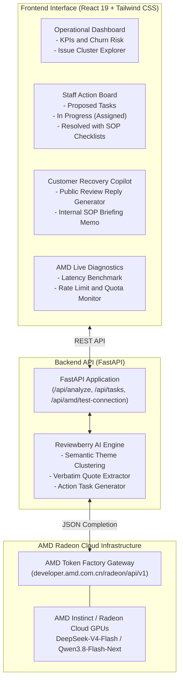

# Reviewberry: Customer Complaints Become Business Tasks

> **Event:** AMD Developer Hackathon: ACT III (On-site in Rome, Italy)  
> **Track:** Track 3 by Vibe Generation: Reinvent Commerce  
> **Team:** Voyagers  
> **Team Members:** Nguyen Xuan Hau and Senuke Weragama  
> **Powered by:** AMD Token Factory (AMD Radeon Cloud AI Endpoints)  
> **Repository:** <https://github.com/senu-io/Reviewberry>  

---

## Project Summary

Retailers, restaurants, and e-commerce merchants are inundated with customer feedback across Google Maps, Yelp, Deliveroo, Just Eat, Trustpilot, and direct support tickets. Today, businesses face an operational dilemma:

1. **Unstructured text is ignored**, and management only monitors a crude star rating.
2. **Traditional sentiment dashboards** report passive statistics like "68% negative sentiment", leaving store managers asking: **"What do my staff actually need to do?"**

Reviewberry bridges the gap between raw customer sentiment and frontline operational execution. Powered by AMD Token Factory on AMD Radeon Cloud GPUs, Reviewberry groups differently phrased complaints into root-cause clusters, extracts verbatim quotes as evidence, and automatically generates concrete, assignable business tasks complete with Standard Operating Procedure (SOP) action checklists, department assignees, and public recovery replies.

For complete technical specifications, architectural rationales, schema definitions, and design trade-offs, please refer to the dedicated [DOCUMENTATION.md](file:///d:/Other/Projects/LabLab.AI/AMD_ACT_III/Reviewberry/DOCUMENTATION.md).

## AMD Radeon Cloud and Token Factory Integration

Reviewberry is natively integrated with AMD Token Factory (`https://developer.amd.com.cn/radeon/api/v1`), utilizing models hosted directly on AMD Radeon Cloud GPU infrastructure:

- **Active Model:** DeepSeek-V4-Flash (1,048,576 token context window, high inference throughput) or Qwen3.8-Flash-Next (262,144 token context window, advanced reasoning).
- **Endpoint Protocol:** OpenAI-compatible `/v1/chat/completions` with strict `response_format: {"type": "json_object"}` enforcement.
- **Hardware Telemetry:** Real-time hardware status banner displaying connection state, roundtrip latency (in milliseconds), and active token quotas.
- **Live Connection Diagnostics:** Built-in connection tester with live GPU ping benchmarking, real-time rate limit tracking (`x-ratelimit-remaining-user-rpm`), and daily spend balance monitoring.
- **Resilience Engine:** Automatic 429 rate limit backoff and intelligent offline simulation fallback, ensuring the application is 100% presentation-ready even under venue network constraints.

---

## System Architecture and Data Flow



---

## Key Functional Capabilities

### 1. 1-Click Interactive Demos for Evaluation

Judges and mentors can evaluate Reviewberry instantly with zero setup:

- **Trattoria Luigi and Delivery (Rome, Italy):** Identifies cold food transit failures, uninsulated courier bags, omitted cannoli/dipping sauces, and POS receipt address truncation in Trastevere.
- **UrbanVibe Boutique (Milan, Italy):** Identifies linen shirts running 2 sizes smaller than EU sizing charts, self-checkout RFID tag alarms, and return refund backlogs.

### 2. Live AMD Token Factory Diagnostics

Click "Test AMD Connection" in the top navigation bar to execute a real-time probe to the AMD Radeon Cloud cluster, benchmark latency, and inspect active rate limits.

### 3. Semantic Root-Cause Clustering

Instead of counting keywords, Reviewberry connects differently phrased complaints:

- "Rigatoni carbonara was ice cold" + "Courier had no thermal bag" + "Driver waited 25 mins at the kitchen" -> **Cluster: Cold Delivery Transit and Thermal Bag Deficit**.

### 4. Verbatim Customer Evidence

Displays exact quotes, reviewer names, channels (Deliveroo, Google Maps, Yelp), and sentiment scores so managers can review the primary source evidence.

### 5. Frontline Staff Action Board (Kanban)

Moves complaints into actionable staff deliverables:

- **Department and Role:** Kitchen Operations and Dispatch -> Head Chef.
- **Priority and Target Time:** P1 - Urgent -> 24 hours.
- **Interactive Action Checklist:** Step-by-step instructions that team members can check off.
- **Expected Business Outcome:** Quantifies impact (such as "Eliminate lukewarm food delivery complaints by 85%").

### 6. Closed-Loop Customer Recovery and Staff Briefing

- **Public Review Reply Generator:** Generates an empathetic response addressing the reviewer by name and explicitly citing the operational upgrade implemented.
- **Internal SOP Briefing Memo:** Generates a formatted briefing memo ready for management to distribute to staff.

---

## Technology Stack Summary

- **Backend:** Python 3.11+, FastAPI, Uvicorn, Pydantic v2, HTTPX, python-multipart, python-dotenv.
- **Frontend:** React 19, Vite 5, Tailwind CSS ("Midnight Obsidian and Cyber-Berry" custom palette), Lucide React.
- **AI Infrastructure:** AMD Radeon Cloud Token Factory (`https://developer.amd.com.cn/radeon/api/v1`), DeepSeek-V4-Flash.
- **Deployment:** Multi-stage Dockerfile, Docker Compose, Git.

For an exhaustive explanation of why each technology was chosen, refer to [DOCUMENTATION.md](file:///d:/Other/Projects/LabLab.AI/AMD_ACT_III/Reviewberry/DOCUMENTATION.md#5-key-design-choices-architectural-rationales-and-trade-offs).

---

## Quickstart and Installation Guide

### Prerequisites

- Python 3.10 or higher
- Node.js 18 or higher (optional, for frontend development)
- Docker and Docker Compose (optional, for containerized run)

### Option 1: Unified Full-Stack Run (Fastest)

The production React frontend is pre-compiled into `frontend/dist/`. FastAPI serves the API and the user interface from a single port:

```powershell
# 1. Activate virtual environment
.\venv\Scripts\activate

# 2. Start server
python -m uvicorn app.main:app --host 0.0.0.0 --port 8000 --app-dir backend
```

Access the application at: **<http://localhost:8000>**

---

### Option 2: Run with Docker

```bash
# Clone the repository
git clone https://github.com/senu-io/Reviewberry.git
cd Reviewberry

# Build and start container
docker-compose up --build
```

Access the application at: **<http://localhost:8000>**

---

### Option 3: Local Development with Hot Reloading

```powershell
# Terminal 1: Backend
python -m uvicorn app.main:app --host 0.0.0.0 --port 8000 --app-dir backend --reload

# Terminal 2: Frontend
cd frontend
npm install
npm run dev
```

Open **<http://localhost:3000>** in your browser. API requests proxy to port 8000.

---

## Configuration and Environment Variables

Reviewberry uses the AMD Token Factory API key configured in `.env`:

```env
RADEON_API_KEY=rc-865fcca81bbe7aa3914e89a3a3c40c53d8adc246ac4703c2
RADEON_BASE_URL=https://developer.amd.com.cn/radeon/api/v1
AMD_MODEL=DeepSeek-V4-Flash
PORT=8000
HOST=0.0.0.0
USE_MOCK_FALLBACK=true
```

Note on resilience: `USE_MOCK_FALLBACK=true` ensures that if venue Wi-Fi drops or rate limits occur during an evaluation, Reviewberry continues to function without interruption.

---

## Team and Attribution

Built for the **AMD Developer Hackathon: ACT III** in Rome, Italy:

- **Team Name:** Voyagers
- **Team Members:**
  - **Nguyen Xuan Hau**
  - **Senuke Weragama**
- **Track:** Track 3 by Vibe Generation: Reinvent Commerce
- **Detailed Documentation:** [DOCUMENTATION.md](file:///d:/Other/Projects/LabLab.AI/AMD_ACT_III/Reviewberry/DOCUMENTATION.md)

---

## Three-Minute Live Presentation Script

1. **The Hook (0:00 to 0:30):**  
   "Every merchant gets bad reviews. But current tools only provide passive dashboards like '72% negative sentiment'. Managers look at the chart and say: 'Now what?'. Team Voyagers presents Reviewberry: customer complaints become business tasks."
2. **The Hardware Connection (0:30 to 0:50):**  
   "Click 'Test AMD Connection'. We are communicating directly in real time with AMD Token Factory hosted on AMD Radeon Cloud GPUs, verifying latency and our active token quota."
3. **The Problem and Scenario (0:50 to 1:30):**  
   "Here in Rome, Trattoria Luigi has 12 recent delivery complaints. Customers say 'food was frozen', 'driver was late', 'sauce was missing'. With one click, Reviewberry feeds this unstructured data to DeepSeek-V4-Flash running on AMD Radeon Cloud."
4. **The AI Transformation (1:30 to 2:15):**  
   "Notice how the AMD-accelerated engine did not just count keywords. It grouped these reviews into 4 root causes: Cold Delivery Transit, Missing Items, Container Leakage, and POS Address Truncation. It pulls verbatim quotes as proof."
5. **The Action Board and Closed Loop (2:15 to 2:45):**  
   "Click 'Staff Action Board'. Reviewberry immediately assigned a P1 task to the Head Chef to standardize thermal delivery bags with a 4-point checklist. With one more click, our Customer Recovery Copilot writes a public apology to Marco Rossi explaining the exact fix, and generates an internal SOP briefing memo for kitchen staff."
6. **Conclusion and Track Fit (2:45 to 3:00):**  
   "Reviewberry reinvents commerce by converting customer friction into accountability, operational excellence, and retained revenue, all powered by AMD Radeon Cloud."

---
