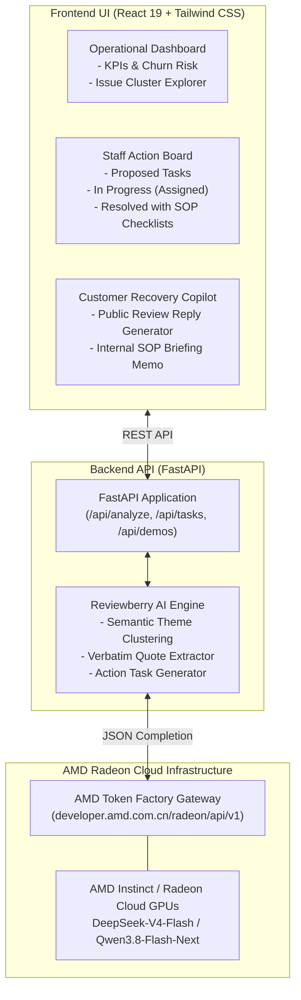

# 🍓 Reviewberry — Customer Complaints Become Business Tasks

> **AMD Developer Hackathon: ACT III (Rome, Italy)**  
> **Track 3 by Vibe Generation:** Reinvent Commerce  
> **Powered by:** AMD Token Factory (AMD Radeon™ Cloud AI Endpoints)  
> **Repository:** [https://github.com/your-team/reviewberry](https://github.com/your-team/reviewberry)

---

## 📌 Executive Summary

Retailers and restaurants are flooded with customer feedback across Google Maps, Yelp, Deliveroo, Just Eat, Trustpilot, and direct support tickets. Today, businesses face an operational dilemma:
1. **Unstructured text is ignored**, and management only looks at a crude star rating.
2. **Traditional sentiment dashboards** report statistics like *"68% negative sentiment"*, leaving store managers asking: **"Okay... but what do my staff actually need to do?"**

**Reviewberry** bridges the gap between raw customer sentiment and frontline operational execution. Powered by **AMD Token Factory** on **AMD Radeon Cloud GPUs**, Reviewberry groups differently-worded complaints into root-cause clusters, extracts verbatim quotes as proof, and automatically generates concrete, assignable business tasks complete with SOP action checklists and department assignees.

```
Raw Unstructured Reviews (Google, Deliveroo, Yelp)
   ↓ [AMD Token Factory: DeepSeek-V4-Flash / Qwen3.8-Flash-Next]
Semantic Clustering & Root Cause Identification
   ↓
Evidence Isolation (Verbatim Customer Quotes & Churn Risk)
   ↓
Actionable Staff Tasks (Role, Priority, SOP Action Checklist)
   ↓
Closed-Loop Resolution (Internal Kanban + AI Customer Recovery Copilot)
```

---

## 🚀 Hackathon Track Alignment: Reinvent Commerce

Track 3 challenges teams to *"turn customer or business data into a useful recommendation or action that helps attract, serve, convert, or retain customers."*

| Track 3 Requirement | Reviewberry Solution |
| :--- | :--- |
| **Real Problem** | Unstructured review data is disconnected from frontline staff actions, resulting in repeated mistakes and preventable customer churn. |
| **Working Product** | Full-stack cloud-native web application with 1-click evaluation datasets, custom CSV ingestion, Kanban task management, and SOP memo generator. |
| **Actionable Output** | Converts vague complaints (*"food was cold"*, *"driver took 1 hr"*) into operational SOP tasks (*"Mandate Thermal Bags & Audit Courier Handoff Times"* for the Head Chef & Dispatch Supervisor). |
| **Customer Retention** | Includes an AI **Customer Recovery Copilot** that drafts public review replies citing the exact operational corrective actions implemented. |

---

## ⚡ AMD Radeon Cloud & Token Factory Integration

Reviewberry is natively integrated with **AMD Token Factory** (`https://developer.amd.com.cn/radeon/api/v1`), utilizing models hosted directly on **AMD Radeon Cloud GPUs**:

- **Model:** `DeepSeek-V4-Flash` (1M context, high throughput) or `Qwen3.8-Flash-Next` (high reasoning capability).
- **Endpoint Protocol:** OpenAI-compatible `/v1/chat/completions` with strict `response_format: {"type": "json_object"}`.
- **Hardware Telemetry:** Real-time hardware status banner displaying connection state, latency (ms), and token usage.
- **Resilience Engine:** Automatic 429 rate limit backoff and intelligent offline simulation fallback, ensuring the app is 100% presentation-ready even under venue network constraints.

---

## 🛠️ Architecture & Data Flow



---

## 🌟 Key Features

### 1. 1-Click Interactive Demos (Immediate Evaluation)
Judges and mentors can evaluate Reviewberry instantly with zero setup:
- 🍕 **Trattoria Luigi & Delivery (Rome, Italy):** Identifies cold food transit failures, uninsulated courier bags, omitted cannoli/dipping sauces, and POS receipt address truncation in Trastevere.
- 👗 **UrbanVibe Boutique (Milan, Italy):** Identifies linen shirts running 2 sizes smaller than EU sizing charts, self-checkout RFID tag alarms, and return refund backlogs.

### 2. Semantic Root-Cause Clustering
Instead of counting keywords, Reviewberry connects differently phrased complaints:
- *"Rigatoni carbonara was ice cold"* + *"Courier had no thermal bag"* + *"Driver waited 25 mins at the kitchen"* $\rightarrow$ **Cluster: Cold Delivery & Extended Courier Transit Time**.

### 3. Verbatim Customer Evidence
Displays exact quotes, reviewer names, channels (Deliveroo, Google Maps, Yelp), and sentiment scores so managers can review the primary source evidence.

### 4. Frontline Staff Action Board (Kanban)
Moves complaints into actionable staff deliverables:
- **Department & Role:** e.g., *Kitchen Operations & Dispatch* $\rightarrow$ *Head Chef*.
- **Priority & Target Time:** e.g., *P1 - Urgent* $\rightarrow$ *24 hours*.
- **Interactive Action Checklist:** Step-by-step instructions that team members can tick off.
- **Expected Business Outcome:** Quantifies impact (e.g. *"Eliminate lukewarm food delivery complaints by 85%"*).

### 5. Closed-Loop Customer Recovery & Staff Briefing
- **Public Review Reply Generator:** Generates an empathetic response addressing the reviewer by name and explicitly citing the operational upgrade implemented.
- **Internal SOP Briefing Memo:** Generates a formatted briefing memo ready for management to distribute to staff.

---

## 🏃 Quickstart Guide

### Prerequisites
- Python 3.10+
- Node.js 18+ (for local frontend dev)
- Docker & Docker Compose (optional, for containerized run)

### Option 1: Run with Docker (Recommended for Cloud)
```bash
# Clone the repository
git clone https://github.com/your-team/reviewberry.git
cd reviewberry

# Configure AMD Token Factory API Key
cp .env.example .env
# Edit .env and insert your AMD Token Factory API key (rc-...)

# Build and start container
docker-compose up --build
```
Access the application at: **`http://localhost:8000`**

---

### Option 2: Local Development Setup

#### 1. Backend Setup (FastAPI)
```bash
# Create and activate virtual environment
python -m venv venv
# On Windows:
.\venv\Scripts\activate
# On Linux/macOS:
source venv/bin/activate

# Install dependencies
pip install -r backend/requirements.txt

# Start backend server
python -m uvicorn app.main:app --host 0.0.0.0 --port 8000 --app-dir backend --reload
```

#### 2. Frontend Setup (React + Vite)
```bash
cd frontend
npm install
npm run dev
```
Open **`http://localhost:3000`** in your browser (API requests automatically proxy to port 8000).

---

## 🔑 AMD Token Factory Configuration

To connect your team's provisioned AMD Token Factory API key:
1. Both team members sign in at [notebooks.amd.com/tokenfactory](https://notebooks.amd.com/tokenfactory) with their registered AMD AI Developer Program emails.
2. Click **"Redeem API Key"**.
3. Once all team members click redeem, copy the `rc-...` key.
4. Add it to `.env`:
```env
RADEON_API_KEY=rc-your-48-character-token-factory-key
RADEON_BASE_URL=https://developer.amd.com.cn/radeon/api/v1
AMD_MODEL=DeepSeek-V4-Flash
USE_MOCK_FALLBACK=true
```

> **Note on Resilience:** `USE_MOCK_FALLBACK=true` ensures that if rate limits (30 RPM) or venue Wi-Fi hiccups occur during judging, Reviewberry gracefully serves intelligent fallback data without crashing or hanging.

---

## 📋 Hackathon Presentation & Demo Script (3-Minute Pitch)

1. **The Hook (0:00 - 0:30):**  
   *"Every merchant gets bad reviews. But current tools only give passive dashboards like '72% negative sentiment'. Managers look at the chart and say: 'Now what?'. Today, we present Reviewberry: customer complaints become business tasks."*
2. **The Problem & Scenario (0:30 - 1:15):**  
   *"Here in Rome, Trattoria Luigi has 12 recent delivery complaints. Customers say 'food was frozen', 'driver was late', 'sauce was missing'. With 1 click, Reviewberry feeds this unstructured data to DeepSeek-V4-Flash running on AMD Radeon Cloud."*
3. **The AI Transformation (1:15 - 2:00):**  
   *"Notice how the AMD-accelerated engine didn't just count keywords. It grouped these reviews into 3 root causes: Cold Delivery Transit, Missing Add-ons, and POS Address Truncation. It pulls verbatim quotes as evidence."*
4. **The Action Board & Closed Loop (2:00 - 2:45):**  
   *"Click 'Staff Action Board'. Reviewberry immediately assigned a P1 task to the Head Chef to standardize thermal delivery bags with a 4-point checklist. With one more click, our Customer Recovery Copilot writes a public apology to Marco Rossi explaining the exact fix, and generates an internal SOP briefing memo for kitchen staff."*
5. **Conclusion & Track Fit (2:45 - 3:00):**  
   *"Reviewberry reinvents commerce by converting customer friction into accountability, operational excellence, and retained revenue—all powered by AMD Radeon Cloud."*

---

## 📄 License
MIT License. Built with passion at the AMD ACT III Hackathon in Rome, Italy.
